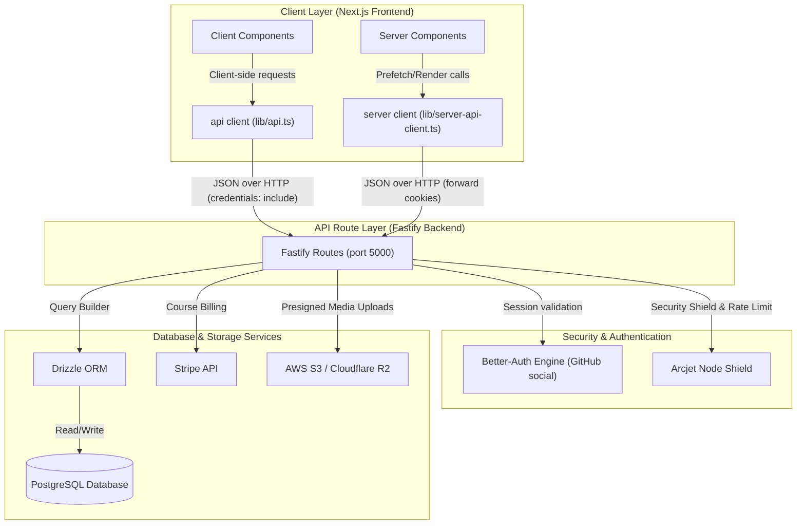
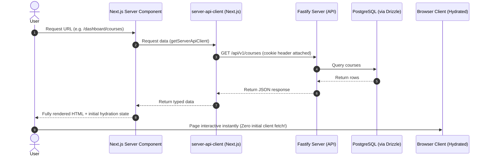

# ViEdSpark - Enterprise-Grade Learning Management System

[](https://nextjs.org)
[](https://nodejs.org)
[](https://drizzle.team)
[](https://better-auth.com)
[](https://arcjet.com)
[](https://tailwindcss.com)
[](https://stripe.com)
[](https://biomejs.dev)
[](https://jestjs.io)

A robust, modern, and highly scalable **Learning Management System (LMS)** designed with visually stunning layouts, premium performance, and enterprise-grade security. Structured as a monorepo utilizing **npm workspaces**, it separates concerns between a high-performance **Fastify v5 backend API** and a cutting-edge **Next.js 16 (React 19) frontend client**, both protected by **Better-Auth v1** and **Arcjet**.

---

## 🏗️ System Architecture & Data Flows

### 🗺️ Infrastructure & Client-Server Communication
The system is divided into two main service layers interacting over secure HTTP channels, ensuring complete isolation and scalability.



### ⚡ Server-Side SSR Hydration Sequence Flow
For high search-engine indexing (SEO) and zero-delay initial loads, data prefetching is executed on the server by proxying requests to the Fastify API before transferring dehydrated states to the client cache:



---

## 🔥 Key Features

### 🎓 For Students & Learners
*   **Interactive Classroom:** Stream responsive video lessons and access beautifully formatted rich-text descriptions.
*   **Real-time Progress Tracking:** Keep track of completed lessons with dynamic visual progress bars.
*   **Gamified Milestones:** Animated `canvas-confetti` celebrations trigger upon course completion to increase student engagement.
*   **Sleek Student Dashboard:** View enrolled courses, completion percentages, total learning achievements, and resume courses with one click.
*   **Premium Visual Aesthetics:** Beautiful dark mode support, subtle micro-animations, glassmorphic headers, and dynamic responsive layouts.

### 🛠️ For Administrators & Instructors
*   **Intuitive Drag-and-Drop builder:** Effortlessly reorder course chapters and lessons using a smooth drag-and-drop workflow powered by `@dnd-kit`.
*   **TipTap Rich Text Editor:** Author professional curriculum contents with full alignment, styles, headers, and media options.
*   **Cloud Media Upload System:** Upload high-resolution cover images and video lessons straight to AWS S3 (or Cloudflare R2) using secure server-generated presigned URLs.
*   **Dynamically Synced Stripe Billing:** Set course pricing directly in the app; Stripe Price IDs are dynamically synchronized on the fly.
*   **Admin Statistics Dashboard:** Visualize platform health, user registration metrics, enrollment rates, and sales revenue analytics powered by **Recharts** graphic components.

---

## 🛠️ Complete Tech Stack

| Layer | Technology | Purpose |
| :--- | :--- | :--- |
| **Frontend Framework** | Next.js 16 (App Router), React 19, TypeScript | Server Components, SEO optimization, client-side routing. |
| **Frontend Styling** | Tailwind CSS v4, PostCSS | Modern utility styling and responsive components. |
| **Frontend UI/UX** | shadcn/ui, Radix UI, `@dnd-kit`, TipTap | Accessible widgets, drag-and-drop course builder, rich-text editor. |
| **Backend Engine** | Fastify v5 framework, tsx, Node.js runtime | High-performance API server. |
| **Backend Database** | Drizzle ORM, Postgres.js, PostgreSQL | Type-safe queries and database schema migrations. |
| **Authentication** | Better-Auth v1 (drizzleAdapter, Social GitHub) | Secure session management, role policies (`admin`), OAuth. |
| **Security Layer** | Arcjet Node Shield | Bot protection, rate limiting, and route authorization. |
| **Third-Party APIs** | Stripe API, AWS S3 / Cloudflare R2 SDK | Dynamic billing checkout and secure media uploads. |
| **Monorepo / Tooling** | npm workspaces, Biome 2.4, Jest 30 | Mono-repository configuration, code linting/formatting, test runner. |

---

## 🚀 Getting Started

### 📋 Prerequisites
Ensure you have the following installed:
*   [Node.js runtime](https://nodejs.org) (v20 or higher)
*   [PostgreSQL Database](https://www.postgresql.org/) (running locally or cloud instances like Neon/Supabase)
*   [Stripe CLI](https://docs.stripe.com/stripe-cli) (for testing payments locally)

### 💻 Step-by-Step Installation

1.  **Clone the Repository:**
    ```bash
    git clone https://github.com/your-username/ViEdSpark.git
    cd ViEdSpark
    ```

2.  **Install Dependencies:**
    Using npm workspaces from the root folder:
    ```bash
    npm install
    ```

3.  **Populate Local Environment Variables:**
    Copy the sample and fill in your custom API credentials for both workspaces:
    - Set up `backend/.env` for the Fastify server.
    - Set up `frontend/.env` for the Next.js application.

4.  **Database Migration & Schema Sync:**
    From the root, generate and run database migrations using Drizzle:
    ```bash
    # Generate migrations based on schema.ts changes
    npm run db:generate

    # Push and apply migrations to your PostgreSQL database
    npm run db:migrate
    ```

    > [!TIP]
    > To explore database records visually, use Drizzle Kit Studio commands inside the backend directory (`npx drizzle-kit studio`).

5.  **Set Up Local Stripe Webhooks:**
    To receive payment confirmation events on your local machine, run the Stripe CLI listening daemon:
    ```bash
    stripe listen --forward-to localhost:5000/api/v1/webhooks/stripe
    ```
    Copy the outputted webhook signature secret (starts with `whsec_`) and insert it into your backend `.env` as `STRIPE_WEBHOOK_SECRET`.

6.  **Verify Quality Check & Test Suite:**
    Ensure linting, formatting, and Jest test suites compile and pass successfully:
    ```bash
    # Format and check quality using Biome
    npm run check

    # Run unified test suites
    npm run test
    ```

7.  **Run Development Servers:**
    Spin up the dev environment concurrently for both workspaces:
    ```bash
    npm run dev
    ```

    Open the web app at [http://localhost:3000](http://localhost:3000) (Next.js) and check Fastify backend routing at [http://localhost:5000](http://localhost:5000).

---

## 🛠️ Type-Safe Development Workflow

To implement new features or modify existing API endpoints, follow this consistent workflow:

1. **Schema Design:** Modify Drizzle schemas in `backend/src/db/schema.ts` and apply database updates (`npm run db:generate` & `npm run db:migrate`).
2. **Implement Repository & Service Layers:**
   - Define database operations inside `backend/src/db/repository/` (e.g. `courseRepository.ts`).
   - Define high-level business logic, SQS queue operations, or external services integrations inside `backend/src/services/` (e.g. `courseService.ts`).
3. **Implement Controller & Lean Route:**
   - Create request/response handlers in `backend/src/controllers/api/v1/` (e.g. `courseController.ts`) to manage HTTP inputs and error responses.
   - Register endpoints in `backend/src/routes/api/v1/` passing controller functions as handlers.
4. **Frontend API Configuration:**
   - For Client Components: Add the endpoint interface/fetch wrapper under `frontend/lib/api.ts`.
   - For Server Components: Add the endpoint proxy/fetch mapper under `frontend/lib/server-api-client.ts` (if Server Components pre-fetching is required).
5. **Client Consumption:** Call the handlers in your UI components:
   ```typescript
   import { api } from "@/lib/api";

   const handleEnroll = async () => {
     const res = await api.courses.enroll(courseId);
     if (res.checkoutUrl) window.location.href = res.checkoutUrl;
   };
   ```

---

## 📂 Project Structure

```
├── backend/                    # Fastify API Server
│   ├── drizzle/                # Database migrations
│   ├── src/
│   │   ├── config/             # Environment validators
│   │   ├── controllers/        # Request/Response validation & HTTP orchestrators
│   │   │   └── api/v1/         # Versioned controller handlers
│   │   ├── db/
│   │   │   ├── repository/     # Data Access layer (SQL builders)
│   │   │   │   └── courseRepository.ts
│   │   │   ├── schema.ts       # Drizzle database schemas
│   │   │   └── index.ts        # DB connection & repo exports
│   │   ├── plugins/            # Fastify custom plugins
│   │   ├── routes/             # Lean HTTP route declarations invoking controllers
│   │   │   └── api/v1/
│   │   ├── services/           # Business Logic layer
│   │   │   ├── courseService.ts
│   │   │   └── storageService.ts
│   │   ├── build-app.ts        # Fastify application configurations
│   │   └── auth.ts             # Better-Auth backend adapter
│   ├── tests/                  # Backend Jest test cases
│   └── package.json
├── frontend/                   # Next.js 16 Web App
│   ├── app/                    # Next.js App Router (dashboard, public pages)
│   ├── components/             # Reusable UI widgets and custom wrappers
│   ├── hooks/                  # Client React hooks
│   ├── lib/                    # API clients (api.ts & server-api-client.ts)
│   ├── tests/                  # Frontend Jest test suites
│   └── package.json
├── docs/                       # Project specs and plans
└── package.json                # Root package for workspace coordination
```

---

## 🚀 Production & Deployment Guidelines

### ⚡ Database Setup
For optimal latency, choose a serverless database provider with proximity to your web hosting region:
*   [Neon Database](https://neon.tech/) (Serverless Postgres with instantaneous branching)
*   [Supabase](https://supabase.com) (Standard relational databases)

### 📦 S3 Storage Bucket Policy
Ensure your S3 bucket (or Cloudflare R2 bucket) has appropriate CORS (Cross-Origin Resource Sharing) permissions enabled. This allows direct client-side uploads of media without overloading the backend/frontend context.

**Sample CORS configuration JSON:**
```json
[
  {
    "AllowedHeaders": ["*"],
    "AllowedMethods": ["GET", "PUT", "POST", "DELETE", "HEAD"],
    "AllowedOrigins": ["http://localhost:3000", "https://your-production-domain.com"],
    "ExposeHeaders": []
  }
]
```

### 🌐 Deploying to Production
1.  **Frontend (Next.js)**: Connect your GitHub repository to [Vercel](https://vercel.com). Configure all environment variables and build using `npm run build`.
2.  **Backend (Fastify)**: Deploy the backend server to Render, Heroku, Fly.io, or any VPS solution. Make sure it points to the production database and CORS allows requests from the frontend domain.
3.  Ensure `BETTER_AUTH_URL` is set to the auth server url, and the frontend links to the production API domain correctly.

---

## 🤝 Contributing

Contributions are always welcome to help improve ViEdSpark!

1.  Fork the Project
2.  Create your Feature Branch (`git checkout -b feature/amazing-feature`)
3.  Commit your Changes (`git commit -m 'Add some amazing-feature'`)
4.  Push to the Branch (`git push origin feature/amazing-feature`)
5.  Open a Pull Request

---

## 📄 License

This software is distributed under the **MIT License**. Check out the `LICENSE` file for more details.


## API business verification

Bruno requests, the standalone fixture helper, runner and coverage inventory live in `bruno/`; product integration regressions live in `backend/tests/integration/`. See [Bruno setup and Native Desktop instructions](bruno/README.md).

```sh
DATABASE_URL="$TEST_DATABASE_URL" NODE_ENV=test BRUNO_DESKTOP_HELPERS_ENABLED=true BRUNO_DESKTOP_HELPER_TOKEN=bruno-desktop-local-token npm run bruno:helper
npm run test:api:smoke
npm run test:api:core
npm run test:api
npm run test:bruno:tooling
TEST_DATABASE_URL=<isolated-test-database> npm run test:integration
npm run test:api:coverage -- --evidence .bruno-reports/evidence.json
```

Start the API and explicitly enabled loopback helper against the same isolated test database before mutable suites. Core needs no storage/payment preflight; the complete collection requires test S3 and Stripe configuration. Interrupted runs recover through `npm run test:api:cleanup -- --run-id <uuid> --suite <suite>`. See [verification evidence and outstanding manual checks](docs/testing/bruno-verification.md).

## Test ownership and browser verification

The testing stack is **Jest + Playwright Test + Bruno**. Jest checks product logic, UI and PostgreSQL regressions. Playwright checks browser journeys against the real Next.js frontend and Fastify backend. Bruno checks HTTP workflows on a running API; its Jest tests check the tooling itself.

Only `frontend`, `backend`, `bruno` and `docs` own code/documents at the root. Backend test support owns common LMS data builders; Bruno retains its manifest, recovery and provider cleanup. Scripts reside in `backend/scripts`, `bruno/tooling` or `docs/presentation`.

```sh
npm test
npm run check:all
npm run test:integration
npm run test:bruno:integration
npm run test:e2e:install
npm run test:e2e
```

The three integration/browser commands require `TEST_DATABASE_URL` pointing to a migrated isolated PostgreSQL database with `test` in its name. They fail when it is missing. `npm test` needs no running server. Run database migration against that explicit isolated URL before the first integration/browser run.

Playwright owns ports 5002 (API) and 3002 (frontend), builds the frontend with the matching API URL, and refuses to reuse an existing server. Chromium journeys check email login/session reload, refusal of unenrolled access, persisted progress and isolation between learners. Each browser test prepares its own UUID-scoped data through the BE CLI and cleans it in teardown. It does not depend on the Bruno helper, Stripe or S3.

If a browser run is forcibly terminated, use the scope from the interrupted setup/trace to recover its DB fixtures:

```sh
node --import tsx backend/tests/support/e2e-fixtures.ts cleanup --scope <uuid>
```

`frontend/test-results` and `frontend/playwright-report` are ignored local reports. Trace files can contain credentials/cookies; do not publish them without redaction. `npm run build` builds the product; `build:bruno` checks tooling separately. `check:boundaries` rejects imports that violate ownership. See [verification report](docs/testing/test-boundaries-verification.md).

Sample course preparation now defaults to `backend/sample-courses`; run `npm run sample-courses:prepare`. The course importer uses that same directory.
