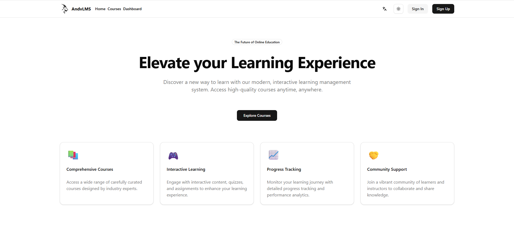
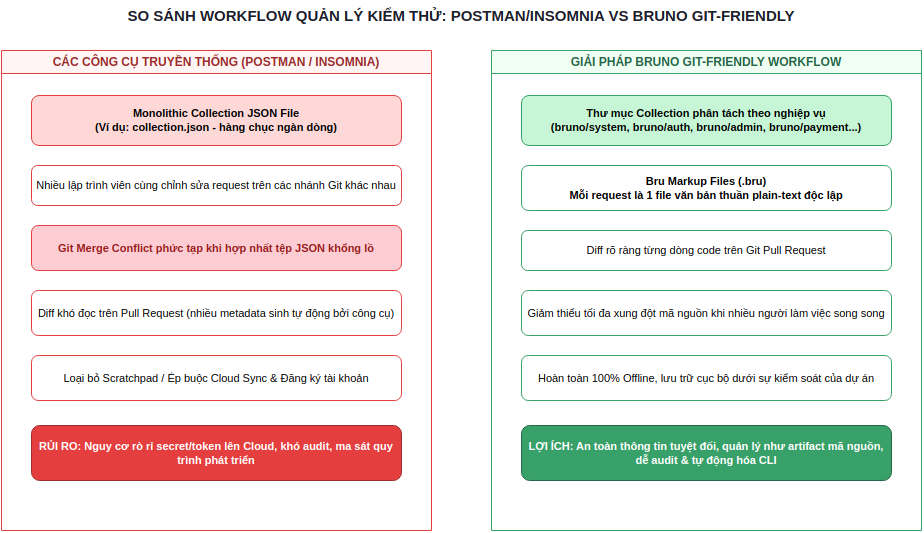
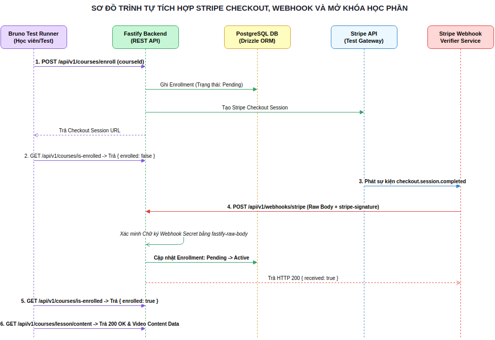
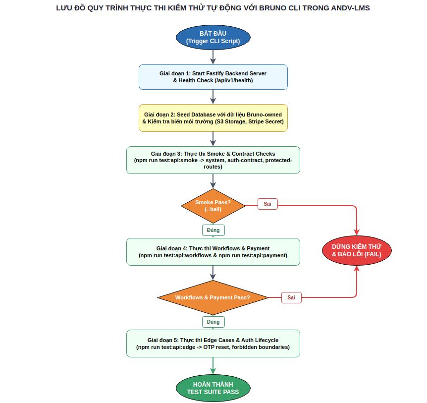
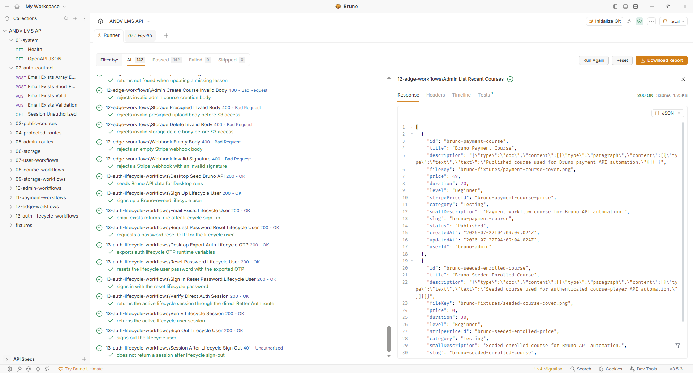
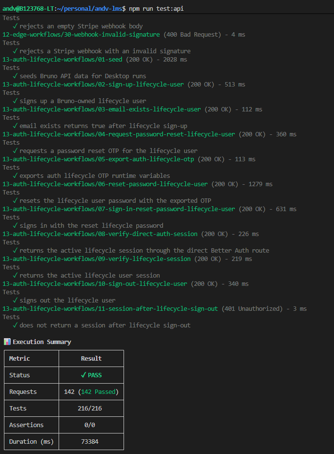
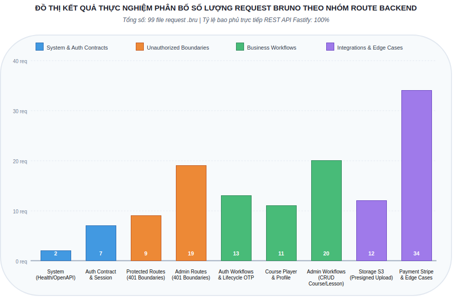

::: {.markdown-only}

# Mục lục

- [Tóm tắt](#tóm-tắt)
- [Đóng góp chính](#đóng-góp-chính)
- [Từ khóa](#từ-khóa)
- [1. Tổng quan kiểm thử API](#1-tổng-quan-kiểm-thử-api)
  - [1.1. Bối cảnh ứng dụng trong LMS](#11-bối-cảnh-ứng-dụng-trong-lms)
  - [1.2. Nhu cầu kiểm thử có khả năng audit](#12-nhu-cầu-kiểm-thử-có-khả-năng-audit)
  - [1.3. Mục tiêu, phạm vi, phương pháp nghiên cứu](#13-mục-tiêu-phạm-vi-phương-pháp-nghiên-cứu)
- [2. Giải pháp Bruno & Workflow Git-friendly](#2-giải-pháp-bruno--workflow-git-friendly)
  - [2.1. So sánh Bruno với Postman, Insomnia](#21-so-sánh-bruno-với-postman-insomnia)
  - [2.2. Cấu trúc Bruno & Bru Markup](#22-cấu-trúc-bruno--bru-markup)
  - [2.3. Quản lý biến, scripting, assertions](#23-quản-lý-biến-scripting-assertions)
  - [2.4. Khả năng tự động hóa với CLI, Desktop](#24-khả-năng-tự-động-hóa-với-cli-desktop)
- [3. Thiết kế bộ kiểm thử API cho Andv-LMS](#3-thiết-kế-bộ-kiểm-thử-api-cho-andv-lms)
  - [3.1. Nguyên tắc thiết kế & mô hình dữ liệu](#31-nguyên-tắc-thiết-kế--mô-hình-dữ-liệu)
  - [3.2. Kiểm thử xác thực, phân quyền tài khoản](#32-kiểm-thử-xác-thực-phân-quyền-tài-khoản)
  - [3.3. Kiểm thử nghiệp vụ khóa học, tiến độ](#33-kiểm-thử-nghiệp-vụ-khóa-học-tiến-độ)
  - [3.4. Kiểm thử chức năng quản trị, hồ sơ](#34-kiểm-thử-chức-năng-quản-trị-hồ-sơ)
  - [3.5. Kiểm thử tích hợp Storage, Stripe Payment](#35-kiểm-thử-tích-hợp-storage-stripe-payment)
  - [3.6. Kiểm thử trường hợp biên, độ bao phủ API](#36-kiểm-thử-trường-hợp-biên-độ-bao-phủ-api)
- [4. Thực nghiệm & Đánh giá](#4-thực-nghiệm--đánh-giá)
  - [4.1. Quy trình thực thi kiểm thử tự động](#41-quy-trình-thực-thi-kiểm-thử-tự-động)
  - [4.2. Kết quả đạt được & giá trị ứng dụng](#42-kết-quả-đạt-được--giá-trị-ứng-dụng)
  - [4.3. Hạn chế, hướng phát triển](#43-hạn-chế-hướng-phát-triển)
- [5. Kết luận](#5-kết-luận)
- [Tài liệu tham khảo](#tài-liệu-tham-khảo)

# Danh mục bảng biểu

- [Bảng 1. Đặc điểm kỹ thuật của hệ thống thử nghiệm Andv-LMS](#bang-1)
- [Bảng 2. So sánh Bruno, Postman và Insomnia theo yêu cầu của đề tài](#bang-2)
- [Bảng 3. Tổ chức collection Bruno trong dự án Andv-LMS](#bang-3)
- [Bảng 4. Nhóm lệnh thực thi Bruno API test trong dự án](#bang-4)
- [Bảng 5. Đối chiếu nhóm route backend với phạm vi Bruno coverage](#bang-5)
- [Bảng 6. Kết quả thực thi thực nghiệm các bộ kiểm thử Bruno API](#bang-6)

# Danh mục hình vẽ

- [Hình 1. Giao diện trang chủ (Homepage) ứng dụng học tập trực tuyến Andv-LMS](#hinh-1)
- [Hình 2. Kiến trúc hệ thống Andv-LMS và vị trí bộ kiểm thử Bruno API](#hinh-2)
- [Hình 3. So sánh workflow kiểm thử giữa Bruno (Bru Markup) và Postman/Insomnia](#hinh-3)
- [Hình 4. Sơ đồ trình tự tích hợp Stripe Checkout, Webhook và mở khóa học phần](#hinh-4)
- [Hình 5. Lưu đồ quy trình thực thi kiểm thử tự động với Bruno CLI](#hinh-5)
- [Hình 6. Giao diện quản lý bộ sưu tập và kết quả thực thi kịch bản kiểm thử trên Bruno Desktop](#hinh-6)
- [Hình 7. Màn hình kết quả thực thi tự động toàn bộ bộ kiểm thử Bruno API qua CLI trong Terminal](#hinh-7)
- [Hình 8. Đồ thị phân bố độ bao phủ kiểm thử API theo nhóm route backend](#hinh-8)

:::

::: {.report-cover}
:::

::: {.word-contents}
:::

# Tóm tắt

Báo cáo nghiên cứu giải pháp kiểm thử API tự động dựa trên Git-friendly workflow với công cụ Bruno và thử nghiệm trên hệ thống Andv-LMS. Trong bối cảnh hệ thống web hiện đại ngày càng phụ thuộc vào API để kết nối frontend, backend, cơ sở dữ liệu và các dịch vụ bên ngoài, kiểm thử API trở thành một lớp kiểm soát quan trọng nhằm bảo vệ hợp đồng dữ liệu, xác thực, phân quyền và các workflow nghiệp vụ. Đề tài tập trung vào Bruno như một công cụ lưu trữ request API bằng file văn bản có thể quản lý cùng mã nguồn, review qua Git, chạy bằng CLI và hỗ trợ thao tác tương tác qua Bruno Desktop. Phần thực nghiệm được triển khai trên Andv-LMS, một hệ thống quản lý học tập sử dụng Next.js, Fastify, PostgreSQL, Drizzle ORM, Better Auth, Arcjet, Stripe và hạ tầng lưu trữ tương thích S3. Kết quả chính của đề tài là một bộ kiểm thử API được tổ chức theo workflow nghiệp vụ, bao phủ các nhóm xác thực, phân quyền, khóa học, ghi danh, tiến độ học tập, quản trị khóa học, hồ sơ người dùng, storage, payment, webhook và edge cases. Báo cáo cũng đánh giá khả năng thực thi bằng Bruno CLI, hỗ trợ kiểm thử có kiểm soát bằng Bruno Desktop, theo dõi route coverage bằng tài liệu nội bộ và đề xuất hướng mở rộng sang CI/CD, báo cáo kiểm thử, fuzzing và kiểm thử hiệu năng.

# Đóng góp chính

Đóng góp chính của báo cáo là trình bày một cách tiếp cận kiểm thử API có thể quản lý như artifact mã nguồn thay vì chỉ là thao tác thủ công trên công cụ gửi request. Báo cáo phân tích Bruno ở góc nhìn Git-friendly, automation-ready và audit-friendly; thiết kế bộ kiểm thử cho Andv-LMS theo từng workflow nghiệp vụ; mô tả cách dùng assertions, scripts, biến môi trường, seed dữ liệu và helper routes trong môi trường kiểm thử có kiểm soát; đồng thời đối chiếu từng nhóm route backend với request Bruno tương ứng để đánh giá phạm vi bao phủ. Cách tiếp cận này giúp biến kiểm thử API thành một phần của quy trình phát triển phần mềm, có khả năng review, tái chạy, truy vết và mở rộng cho các môi trường development hoặc staging.

# Từ khóa

Kiểm thử API; Bruno; Git-friendly workflow; kiểm thử tự động; LMS; Fastify; Better Auth; Stripe webhook.

# 1. Tổng quan kiểm thử API

## 1.1. Bối cảnh ứng dụng trong LMS

Trong các hệ thống web nhiều tầng, API là lớp trung gian kết nối giao diện người dùng, tầng xử lý nghiệp vụ, cơ sở dữ liệu và các dịch vụ bên ngoài. Với hệ thống quản lý học tập trực tuyến, vai trò của API còn rõ hơn vì một request có thể ảnh hưởng trực tiếp tới trạng thái học tập, quyền truy cập khóa học, dữ liệu thanh toán hoặc thông tin cá nhân của người dùng. Nếu giao diện hiển thị là phần người dùng nhìn thấy, API là hợp đồng kỹ thuật và nghiệp vụ xác định dữ liệu nào được phép đọc, dữ liệu nào được phép ghi, người dùng nào được phép thực hiện hành động và hệ thống phản hồi ra sao khi có lỗi.

Kiểm thử phần mềm có thể được triển khai ở nhiều lớp, từ unit test ở mức hàm hoặc module, integration test ở mức kết nối thành phần, API test ở mức endpoint và end-to-end test ở mức giao diện người dùng. Trong mô hình test pyramid, kiểm thử ở lớp thấp thường có chi phí rẻ và phản hồi nhanh hơn kiểm thử giao diện, trong khi kiểm thử giao diện vẫn cần thiết để xác nhận trải nghiệm cuối cùng của người dùng [1]. Kiểm thử API nằm ở vị trí trung gian quan trọng: đủ gần business logic để phát hiện lỗi nghiệp vụ, nhưng không phụ thuộc quá nhiều vào rendering, trình duyệt, layout hoặc tương tác giao diện.

Đối với Andv-LMS, API không chỉ trả về dữ liệu khóa học công khai mà còn kiểm soát trạng thái đăng nhập, session, quyền admin, presigned URL phục vụ upload media, tạo Stripe Checkout Session và xử lý Stripe webhook. Các API này tạo thành hợp đồng giữa frontend Next.js, backend Fastify, PostgreSQL, Better Auth, Stripe và storage service tương thích S3, là những thành phần có tài liệu kỹ thuật và hợp đồng tích hợp riêng cần được tôn trọng khi kiểm thử [2-6]. Nếu hợp đồng API bị thay đổi mà không được phát hiện, lỗi có thể xuất hiện ở nhiều nơi: học viên không xem được bài học đã mua, admin không cập nhật được cấu trúc khóa học, webhook thanh toán không mở khóa enrollment hoặc storage tạo URL sai khiến upload thất bại.

Vì vậy, kiểm thử API trong đề tài này không được xem như một tập request rời rạc, mà là một cơ chế kiểm soát chất lượng cho các luồng nghiệp vụ có trạng thái. Một request đăng nhập chỉ có ý nghĩa khi session sinh ra được dùng để truy cập route được bảo vệ; một request hoàn thành bài học chỉ có ý nghĩa khi trạng thái lesson progress sau đó được đọc lại; một webhook thanh toán chỉ có ý nghĩa khi enrollment chuyển sang trạng thái cho phép truy cập khóa học. Đây là lý do báo cáo chọn cách tổ chức kiểm thử theo workflow nghiệp vụ thay vì chỉ liệt kê endpoint.

Giao diện trang chủ (Homepage) của hệ thống học tập Andv-LMS được thể hiện chi tiết trong [Hình 1]. Màn hình thể hiện bố cục thiết kế hiện đại, danh mục khóa học nổi bật và các thành phần tương tác chính mà học viên tiếp xúc trước khi thực hiện các yêu cầu API bên dưới.

{width=6.0in}

Sơ đồ kiến trúc tổng quan hệ thống Andv-LMS cùng vị trí tác động và ranh giới bảo vệ của bộ kiểm thử Bruno API được thể hiện trong [Hình 2]. Sơ đồ minh họa mối liên kết giữa tầng giao diện Next.js, tầng xử lý backend Fastify, cơ sở dữ liệu PostgreSQL, engine xác thực Better Auth, các dịch vụ bên ngoài và các phương thức thực thi Bruno CLI cũng như Bruno Desktop. Các thông số đặc điểm kỹ thuật chính của hệ thống thử nghiệm Andv-LMS được tổng hợp trong [Bảng 1].

{width=6.0in}

Table: Bảng 1. Đặc điểm kỹ thuật của hệ thống thử nghiệm Andv-LMS

Thành phần | Công nghệ sử dụng | Vai trò trong hệ thống | Ý nghĩa đối với kiểm thử API
--- | --- | --- | ---
Frontend | Next.js, React, TypeScript | Cung cấp trang khóa học công khai, khu vực học tập, thanh toán, hồ sơ và quản trị | API test bảo vệ hợp đồng dữ liệu mà frontend sử dụng
Backend | Fastify, TypeScript | Cung cấp REST API, OpenAPI document, xử lý xác thực, nghiệp vụ khóa học, storage và webhook | Là đối tượng kiểm thử chính của Bruno collection
Dữ liệu | PostgreSQL, Drizzle ORM | Lưu user, profile, course, chapter, lesson, enrollment và lesson progress | Kiểm thử cần xác minh trạng thái dữ liệu trước và sau workflow
Xác thực | Better Auth | Quản lý đăng nhập, đăng ký, session, đăng xuất và reset mật khẩu | Bruno cần kiểm tra session hợp lệ, session thiếu và lifecycle tài khoản
Bảo vệ API | Arcjet | Bổ sung lớp bảo vệ request, bot detection và rate limiting ở auth adapter | Kiểm thử xác thực cần chạy trong môi trường cấu hình kiểm soát
Thanh toán | Stripe | Tạo checkout session và xử lý sự kiện webhook | Bruno cần kiểm tra checkout, webhook chữ ký hợp lệ và mở khóa enrollment
Lưu trữ media | S3 hoặc R2 tương thích S3 | Cấp presigned URL, upload cover, thumbnail và video | Bruno kiểm thử end-to-end từ API cấp URL tới upload và xóa file
API automation | Bruno CLI, Bruno Desktop, Bru Markup | Lưu collection bằng file, chạy request, scripts, assertions và biến môi trường | Là giải pháp kiểm thử API chính được nghiên cứu trong báo cáo

## 1.2. Nhu cầu kiểm thử có khả năng audit

Một khó khăn lớn trong việc phát triển và vận hành hệ thống phần mềm là sự thiếu đồng bộ giữa mã nguồn ứng dụng và các kịch bản kiểm thử API. Các công cụ kiểm thử truyền thống như Postman và Insomnia từng là giải pháp phổ biến, nhưng xu hướng thương mại hóa gần đây của họ đã tạo ra nhiều rào cản đáng kể. Việc Postman loại bỏ tính năng Scratchpad ngoại tuyến và Insomnia bắt buộc người dùng đăng nhập để đồng bộ dữ liệu lên cloud từ phiên bản 8.0 đã đặt ra thách thức lớn về an toàn thông tin [12, 13]. Nhiều tổ chức và doanh nghiệp không cho phép tải các thông tin API nhạy cảm, mã token xác thực hoặc dữ liệu người dùng thử nghiệm lên máy chủ của bên thứ ba do các quy định bảo mật nghiêm ngặt. Khi các công cụ này bắt buộc kết nối đám mây, các nhà phát triển phải đối mặt với nguy cơ rò rỉ dữ liệu hoặc mất khả năng làm việc hoàn toàn ngoại tuyến khi mất kết nối mạng.

Bên cạnh vấn đề đám mây, việc cộng tác phát triển và quản lý phiên bản của các bộ kiểm thử API truyền thống cũng gặp nhiều trở ngại. Khi lưu trữ kịch bản dưới dạng một tệp tin JSON lớn duy nhất, việc nhiều lập trình viên cùng thay đổi và đẩy lên Git sẽ tạo ra những xung đột mã nguồn phức tạp, rất khó giải quyết thủ công. Các tệp JSON xuất bản chứa hàng nghìn dòng thuộc tính lồng nhau không được tối ưu hóa cho việc đọc hiểu sự khác biệt qua các dòng mã. Điều này làm suy giảm nghiêm trọng khả năng đánh giá thay đổi trong các phiên kiểm duyệt mã nguồn, dẫn đến việc khó theo dõi ai đã sửa đổi gì, tại sao sửa đổi và thay đổi đó có ảnh hưởng đến hoạt động chung hay không. Do đó, nhu cầu thiết lập một quy trình kiểm thử API có tính năng thân thiện với hệ thống quản lý phiên bản Git, cho phép lưu trữ cục bộ, dễ dàng kiểm duyệt và kiểm tra lịch sử thay đổi trở nên vô cùng cấp thiết cho các dự án hiện đại.

## 1.3. Mục tiêu, phạm vi, phương pháp nghiên cứu

Mục tiêu tổng quát của đề tài là nghiên cứu Bruno như một giải pháp kiểm thử API tự động dựa trên Git-friendly workflow và áp dụng thử nghiệm trên hệ thống Andv-LMS. Mục tiêu cụ thể là phân tích vai trò của Bruno, Bru Markup, assertions, scripting, biến môi trường, Bruno CLI và Bruno Desktop; thiết kế bộ kiểm thử API theo workflow nghiệp vụ của LMS; thực thi các nhóm kiểm thử đại diện; đánh giá mức độ bao phủ route và lợi ích về khả năng review, audit, automation.

Phạm vi của đề tài tập trung vào REST API backend và các workflow có thể kiểm thử hiệu quả bằng HTTP request. Các nhóm chính bao gồm system routes, auth contract, Better Auth lifecycle, protected course routes, admin routes, profile routes, storage routes, Stripe payment routes, webhook routes, desktop helper routes và edge cases. Những nội dung như kiểm thử giao diện người dùng, kiểm thử tải lớn, kiểm thử xâm nhập chuyên sâu, kiểm thử social OAuth redirect bằng trình duyệt và kiểm thử provider-level bên ngoài được xem là phạm vi mở rộng, không phải trọng tâm thực nghiệm của báo cáo.

Phương pháp thực hiện gồm bốn bước. Bước đầu là nghiên cứu tài liệu công cụ Bruno và các công cụ liên quan để xác định tiêu chí Git-friendly, automation-ready và audit-friendly [7-9]. Bước thứ hai là phân tích cấu trúc Andv-LMS, bao gồm route backend, mô hình dữ liệu, scripts npm, fixtures và tài liệu coverage nội bộ. Bước thứ ba là thiết kế và mô tả bộ kiểm thử Bruno theo workflow nghiệp vụ, trong đó mỗi nhóm request gắn với một ranh giới nghiệp vụ cụ thể. Bước cuối là đánh giá kết quả dựa trên khả năng thực thi bằng CLI, mức độ bao phủ route, khả năng phát hiện lỗi xác thực và phân quyền, khả năng xử lý workflow tích hợp bên ngoài và khả năng duy trì collection trong Git.

# 2. Giải pháp Bruno & Workflow Git-friendly

## 2.1. So sánh Bruno với Postman, Insomnia

Trong quy trình phát triển và vận hành phần mềm hiện đại, việc tích hợp kiểm thử API vào vòng đời phát triển đóng vai trò then chốt nhằm bảo đảm tính ổn định và tính chính xác của các dịch vụ. Tuy nhiên, nhiều dự án phần mềm đang gặp phải rào cản lớn khi các công cụ kiểm thử API truyền thống không còn đáp ứng được các tiêu chuẩn về an toàn thông tin, quản lý phiên bản và khả năng cộng tác nhóm. Việc phân tích nguyên nhân gốc rễ của những hạn chế này giúp làm rõ động lực cốt lõi dẫn đến quyết định lựa chọn Bruno làm công cụ kiểm thử chủ đạo trong đề tài.

Thách thức đầu tiên xuất phát từ cơ chế lưu trữ collection và quản lý phiên bản của các công cụ như Postman và Insomnia. Trong nhiều năm, Postman và Insomnia đã thống trị thị trường nhờ giao diện trực quan và hệ sinh thái phong phú. Dù vậy, cách các công cụ này quản lý kịch bản kiểm thử lại tạo ra ma sát lớn đối với quy trình làm việc dựa trên Git. Khi xuất bộ kiểm thử ra môi trường lưu trữ cục bộ, kịch bản thường được gom vào một tệp JSON duy nhất có dung lượng lớn với hàng nghìn dòng thuộc tính lồng phức tạp. Khi nhiều lập trình viên cùng chỉnh sửa request, thêm assertion hoặc cập nhật biến môi trường trên các nhánh Git khác nhau, việc hợp nhất mã nguồn sẽ dẫn đến các xung đột mã nguồn phức tạp. Trình xem sự thay đổi mã nguồn của Git không được thiết kế để phân tích các tệp JSON nguyên khối này, dẫn đến việc các phiên xem xét mã nguồn trên Pull Request trở nên khó khăn, người kiểm duyệt không thể nhận biết đâu là thay đổi nghiệp vụ thật sự và đâu là các siêu dữ liệu tự động sinh ra bởi công cụ [10].

Thách thức thứ hai liên quan đến xu hướng thương mại hóa, phụ thuộc vào dịch vụ đám mây và nguy cơ an toàn thông tin. Việc Postman loại bỏ tính năng Scratchpad hoạt động ngoại tuyến để đẩy người dùng sang mô hình workspace đám mây đã khiến việc làm việc cục bộ bị hạn chế nghiêm trọng. Tương tự, phiên bản 8.0 của Insomnia yêu cầu người dùng phải đăng nhập tài khoản đám mây để đồng bộ dữ liệu, gây ra làn sóng phản đối mạnh mẽ từ cộng đồng mã nguồn mở do rủi ro mất mát kịch bản và nguy cơ rò rỉ dữ liệu [11]. Trong các hệ thống như Andv-LMS hay các ứng dụng doanh nghiệp, bộ kiểm thử API chứa nhiều thông tin nhạy cảm như token xác thực, chuỗi truy vấn cơ sở dữ liệu, khoá ký webhook và thông tin cá nhân của người dùng thử nghiệm. Việc bắt buộc lưu trữ hoặc đồng bộ các dữ liệu này lên đám mây của bên thứ ba tạo ra nguy cơ vi phạm các chính sách an ninh thông tin khắt khe và làm gián đoạn quy trình phát triển khi hệ thống mất kết nối internet.

Trước những thách thức trên, Bruno xuất hiện như một giải pháp mang tính đột phá với triết lý thiết kế ưu tiên lưu trữ cục bộ và thân thiện tuyệt đối với hệ thống quản lý phiên bản Git [12]. Sự khác biệt cốt lõi của Bruno nằm ở việc loại bỏ hoàn toàn các tệp JSON nguyên khối để chuyển sang lưu trữ từng request API thành các tệp văn bản độc lập sử dụng định dạng Bru Markup. Cấu trúc thư mục của Bruno collection phản ánh chính xác cấu trúc thư mục trên hệ thống tệp, cho phép lưu trực tiếp bộ kiểm thử trong cùng repository với mã nguồn ứng dụng. Nhờ đó, mỗi sự thay đổi về request, header, script hay assertion đều sinh ra các dòng khác biệt mã nguồn rõ ràng trong Git, giúp việc kiểm duyệt trên Pull Request diễn ra thuận lợi tương tự như kiểm duyệt mã nguồn ứng dụng Fastify hay Next.js.

Bên cạnh đó, Bruno được phát triển hoàn toàn theo mô hình mã nguồn mở với giấy phép MIT, hoạt động 100% ngoại tuyến và không yêu cầu bất kỳ tài khoản đám mây nào. Mọi tệp kịch bản kiểm thử và biến môi trường đều nằm hoàn toàn dưới sự kiểm soát của dự án, loại bỏ rủi ro rò rỉ dữ liệu và tránh nguy cơ bị khóa tính năng do chính sách thương mại hóa của nhà cung cấp. Bruno cũng cung cấp sự kết hợp đồng nhất giữa ứng dụng Bruno Desktop phục vụ thao tác kiểm thử tương tác và Bruno CLI phục vụ tự động hóa trong quy trình tích hợp liên tục.

Sơ đồ so sánh workflow quản lý bộ kiểm thử giữa mô hình truyền thống (Postman, Insomnia) và mô hình Git-friendly của Bruno được minh họa chi tiết trong [Hình 3]. Sơ đồ làm rõ sự khác biệt giữa việc duy trì một tệp JSON nguyên khối gây xung đột mã nguồn và việc quản lý các tệp `.bru` độc lập có thể review dễ dàng trên hệ thống quản lý phiên bản Git. Bảng tổng hợp so sánh đặc điểm kỹ thuật và đáp ứng yêu cầu giữa ba công cụ được thể hiện trong [Bảng 2].

{width=6.0in}

Table: Bảng 2. So sánh Bruno, Postman và Insomnia theo yêu cầu của đề tài

Tiêu chí | Bruno | Postman | Insomnia | Nhận xét đối với đề tài
--- | --- | --- | --- | ---
Quản lý bằng Git | Lưu request thành file .bru trong thư mục collection | Có thể export collection hoặc dùng cơ chế nền tảng, nhưng diff collection lớn thường khó đọc | Có hỗ trợ đồng bộ và quản lý collection, tùy cách cấu hình | Bruno phù hợp khi repository là nguồn kiểm thử chính
Độ rõ của diff | Request nhỏ, tách theo file và thư mục nghiệp vụ | Collection xuất ra thường có cấu trúc JSON lớn | Có thể rõ hơn khi tổ chức tốt, nhưng vẫn phụ thuộc workflow | Bruno thuận lợi cho review thay đổi test trong pull request
Lưu trữ ngoại tuyến | Hoàn toàn ngoại tuyến, lưu trữ cục bộ trên thư mục dự án | Hạn chế chạy ngoại tuyến sau khi loại bỏ tính năng Scratchpad | Bắt buộc tài khoản và kết nối đám mây từ phiên bản 8.0 | Bruno đảm bảo an toàn thông tin và khả năng tự chủ dữ liệu
Giấy phép và chi phí | Mã nguồn mở hoàn toàn với giấy phép MIT, miễn phí | Thương mại hóa, giới hạn tính năng làm việc nhóm ở bản miễn phí | Thương mại hóa dần, hạn chế tính năng cộng tác ngoại tuyến | Bruno giúp tối ưu chi phí và tránh rủi ro phụ thuộc nhà cung cấp
CLI automation | Có Bruno CLI và lệnh bru run | Có Newman hoặc Postman CLI tùy mô hình sử dụng | Có CLI tùy phiên bản và cấu hình | Cả ba đều có hướng automation, Bruno nổi bật ở nguồn file Git-friendly
Desktop-assisted execution | Có Bruno Desktop dùng cùng collection | Có Postman Desktop và cloud workspace | Có Insomnia Desktop | Bruno Desktop bổ trợ cho cùng artifact test trong repo
Audit workflow | Dễ truy vết từng request, script và assertion qua Git | Phụ thuộc cách xuất collection và quản lý workspace | Phụ thuộc cách đồng bộ và lưu collection | Bruno phù hợp với yêu cầu audit-friendly của đề tài
Phù hợp với Andv-LMS | Cao vì collection nằm trong bruno/ và script npm gọi trực tiếp CLI | Có thể dùng nhưng cần duy trì collection theo cách khác | Có thể dùng nhưng cần thiết kế lại workflow | Đề tài chọn Bruno để giảm ma sát giữa API test và source control

## 2.2. Cấu trúc Bruno & Bru Markup

Bruno là công cụ kiểm thử và làm việc với API được thiết kế theo hướng lưu collection trên hệ thống file. Thay vì coi collection là dữ liệu chỉ tồn tại trong ứng dụng, Bruno lưu request bằng định dạng Bru Markup, cho phép request, headers, body, scripts, assertions và metadata được biểu diễn trong các file văn bản. Đặc điểm này phù hợp với workflow Git-friendly vì thay đổi có thể được xem bằng diff, review trong pull request và quản lý cùng mã nguồn ứng dụng [7].

Bru Markup giữ vai trò như ngôn ngữ mô tả request. Trong một file `.bru`, phần `meta` định danh request và thứ tự chạy, phần method như `get`, `post`, `put` hoặc `delete` mô tả URL và kiểu body, phần `headers` mô tả header, phần `body` mô tả payload hoặc file upload, phần `script:pre-request` chuẩn bị dữ liệu trước khi gửi request và phần `tests` chứa assertions sau khi nhận response. Với cách tổ chức này, một request API không chỉ là thông tin endpoint mà còn chứa kỳ vọng kiểm thử gắn với endpoint đó.

Trong Andv-LMS, Bruno collection được tổ chức theo thư mục nghiệp vụ như `system`, `auth-contract`, `protected-routes`, `admin-routes`, `auth-workflows`, `user-workflows`, `course-workflows`, `admin-workflows`, `storage-workflows`, `payment-workflows`, `auth-lifecycle-workflows`, `edge-workflows` và `desktop-helpers`. Mỗi thư mục thể hiện một mục tiêu kiểm thử rõ ràng. Ví dụ, `protected-routes` tập trung vào trạng thái chưa xác thực, `admin-routes` tập trung vào ranh giới unauthorized của API quản trị, còn `payment-workflows` tập trung vào vòng đời checkout, webhook và mở khóa truy cập khóa học.

Điểm quan trọng của cách tổ chức này là mỗi request đủ nhỏ để review, nhưng toàn bộ collection vẫn tạo thành một bộ test có khả năng bao phủ workflow nhiều bước. Khi một endpoint thay đổi body schema, người review chỉ cần xem file request liên quan. Khi một workflow thanh toán thay đổi, người review có thể xem chuỗi request trong thư mục payment thay vì tìm trong một collection lớn khó tách diff. Đây là khác biệt cốt lõi giữa kiểm thử API theo hướng artifact mã nguồn và kiểm thử API theo hướng thao tác thủ công.

## 2.3. Quản lý biến, scripting, assertions

Assertions là cơ chế giúp Bruno chuyển một request API từ thao tác gửi thử sang kiểm thử có tiêu chí kết quả. Trong collection Andv-LMS, assertions thường kiểm tra HTTP status code, kiểu dữ liệu của response body, giá trị cụ thể như role của user, trạng thái `success`, giá trị boolean `enrolled`, thông tin khóa học, thông tin lesson hoặc thông báo lỗi. Ví dụ, request đăng nhập user kiểm tra response trả `200`, có token dạng chuỗi, email đúng với biến môi trường và role là `user`. Request upload qua presigned URL chấp nhận `200` hoặc `204`, phù hợp với hành vi trả về của storage service.

Scripting trong Bruno giúp xử lý các workflow có trạng thái. Pre-request script có thể lấy runtime variable, gắn header động, thay body bằng payload đã ký hoặc truyền dữ liệu giữa các bước. Trong payment workflow của Andv-LMS, request gửi Stripe webhook không tự tạo payload cố định trong file `.bru`; nó lấy `paymentWebhookPayload` và `paymentWebhookSignature` từ runtime variables, gắn header `stripe-signature` rồi gửi raw body tới backend. Thiết kế này phản ánh đúng đặc điểm của webhook: server chỉ nên chấp nhận sự kiện khi payload và chữ ký khớp với webhook secret trong môi trường kiểm thử [5].

Biến môi trường giúp tách cấu hình khỏi nội dung request. File `bruno/environments/local.bru` định nghĩa `baseUrl`, `frontendUrl`, thông tin tài khoản seed, ID khóa học seed, ID lesson seed, thông tin khóa học payment, email lifecycle và token helper cho Bruno Desktop. Nhờ vậy, cùng một request có thể chạy trong môi trường kiểm thử khác nếu các biến tương ứng được cung cấp. Đây là yêu cầu quan trọng với automation-ready workflow vì test không nên gắn cứng URL, user ID hoặc course ID trực tiếp vào từng request.

Andv-LMS cũng dùng runtime variables để xử lý dữ liệu sinh ra trong khi chạy test. Khi tạo presigned URL, request có thể lưu `uploadUrl` và `key` để request sau upload file và xóa file. Khi tạo course bằng admin workflow, các request sau có thể tìm, cập nhật, tạo chapter, tạo lesson, reorder và xóa dữ liệu vừa tạo. Cơ chế truyền dữ liệu giữa request giúp Bruno kiểm thử workflow nhiều bước nhưng vẫn giữ từng request riêng biệt, dễ đọc và dễ review.

## 2.4. Khả năng tự động hóa với CLI, Desktop

Bruno cung cấp hai cách sử dụng phù hợp với hai nhu cầu khác nhau. Bruno Desktop phù hợp khi người phát triển hoặc kiểm thử viên cần chạy request tương tác, quan sát response, kiểm tra biến runtime và điều tra lỗi trong quá trình phát triển. Bruno CLI phù hợp khi cần thực thi lặp lại từ terminal, tích hợp vào npm scripts hoặc chuẩn bị cho CI/CD [7]. Trong đề tài này, cả hai cách sử dụng đều dựa trên cùng một collection, vì vậy thao tác tương tác và tự động hóa không tách thành hai nguồn kiểm thử khác nhau.

Ở mức CLI, Andv-LMS định nghĩa các script `npm run test:api`, `npm run test:api:full`, `npm run test:api:payment` và `npm run test:api:coverage`. Script đầu chạy các smoke và contract checks nhẹ, không cần seed dữ liệu phức tạp. Các script còn lại gọi runner Node để seed dữ liệu Bruno-owned, kiểm tra cấu hình storage hoặc payment, chạy từng nhóm request bằng `bru run`, xuất runtime variables phục vụ webhook hoặc OTP lifecycle rồi tiếp tục chạy request phụ thuộc trạng thái. Cách chia này giúp quy trình kiểm thử rõ điều kiện tiền đề và rõ phạm vi kiểm tra.

Ở mức Bruno Desktop, dự án cung cấp các helper routes chỉ phục vụ môi trường kiểm thử có kiểm soát. Các helper này hỗ trợ seed dữ liệu, kiểm tra cấu hình storage, kiểm tra cấu hình payment, xuất runtime webhook và lấy OTP cho reset password lifecycle. Chúng chỉ được đăng ký khi cấu hình `BRUNO_DESKTOP_HELPERS_ENABLED=true` và được bảo vệ bằng `x-bruno-helper-token`. Nhờ vậy, Desktop-assisted execution có thể thao tác các workflow phức tạp mà không biến helper thành API nghiệp vụ công khai.

Giá trị chính của Bruno trong đề tài không nằm ở việc chạy request ở một môi trường cụ thể, mà nằm ở collection có cấu trúc, có thể review, có thể tự động hóa và có thể audit. Một collection tốt phải phục vụ cả khi người phát triển cần debug một endpoint bằng Desktop và khi pipeline cần chạy regression bằng CLI. Việc cùng một artifact phục vụ hai ngữ cảnh làm giảm rủi ro lệch kịch bản giữa kiểm thử thủ công và kiểm thử tự động.

# 3. Thiết kế bộ kiểm thử API cho Andv-LMS

## 3.1. Nguyên tắc thiết kế & mô hình dữ liệu

Bộ kiểm thử Bruno cho Andv-LMS được thiết kế theo nguyên tắc bám workflow nghiệp vụ thay vì chỉ bám danh sách route. Nguyên tắc này xuất phát từ bản chất của LMS: một endpoint hiếm khi tồn tại độc lập, mà thường liên quan tới trạng thái người dùng, quyền truy cập, dữ liệu khóa học hoặc kết quả thanh toán. Ví dụ, endpoint lấy nội dung bài học cần được kiểm thử trong nhiều bối cảnh: chưa đăng nhập, đã đăng nhập nhưng chưa ghi danh, đã ghi danh, bài học không tồn tại và sau khi payment webhook mở khóa enrollment.

Nguyên tắc thứ hai là tách các nhóm kiểm thử theo ranh giới trách nhiệm. Nhóm `system` kiểm tra health và OpenAPI document. Nhóm `auth-contract` kiểm tra hợp đồng xác thực cơ bản. Nhóm `protected-routes` và `admin-routes` kiểm tra unauthorized boundary. Nhóm workflow như `course-workflows`, `admin-workflows`, `storage-workflows` và `payment-workflows` kiểm tra chuỗi nghiệp vụ có trạng thái. Nhóm `edge-workflows` kiểm tra invalid input, missing resource, forbidden access và invalid webhook. Cách tách này giúp mỗi thư mục có mục tiêu rõ, dễ mở rộng và dễ chạy riêng khi cần.

Nguyên tắc thứ ba là dữ liệu kiểm thử phải có khả năng tái tạo. Dự án dùng các tài khoản và ID Bruno-owned như `bruno-user@example.com`, `bruno-admin@example.com`, `bruno-seeded-enrolled-course`, `bruno-payment-course` và `bruno-auth-lifecycle@example.com`. Backend có script seed để chuẩn bị trạng thái dữ liệu trước khi chạy workflow phức tạp. Việc đặt tên deterministic giúp request dễ đọc, giảm phụ thuộc vào dữ liệu ngẫu nhiên và cho phép chạy lại test nhiều lần trong môi trường kiểm thử có kiểm soát.

Nguyên tắc thứ tư là mỗi request phải có expected result cụ thể. Request không chỉ gửi HTTP call mà còn có assertions để xác minh response. Các assertions có thể kiểm tra `status`, `message`, `token`, `role`, `enrolled`, dữ liệu profile, course, lesson hoặc kết quả upload. Với route lỗi, assertions kiểm tra status 401, 403, 400 hoặc 404 tùy ranh giới. Đây là điều kiện để Bruno collection trở thành regression test thay vì chỉ là công cụ thử API thủ công. Chi tiết cơ cấu tổ chức các nhóm kịch bản trong collection Bruno của dự án Andv-LMS được tổng hợp trong [Bảng 3].

Table: Bảng 3. Tổ chức collection Bruno trong dự án Andv-LMS

Nhóm collection | Số file `.bru` | Mục tiêu kiểm thử chính | Ví dụ workflow hoặc request đại diện
--- | --- | --- | ---
`system` | 2 | Kiểm tra backend health và OpenAPI document | `health.bru`, `openapi-json.bru`
`auth-contract` | 5 | Kiểm tra hợp đồng session và email-exists | Session unauthorized, email validation, email exists valid
`protected-routes` | 9 | Kiểm tra 401 khi chưa xác thực ở route người dùng | Enrolled courses, lesson content, checkout confirm, profile me
`admin-routes` | 19 | Kiểm tra 401 ở route quản trị | Dashboard stats, course create, lesson update, users list
`auth-workflows` | 4 | Đăng nhập và xác minh session user/admin | Login user, login admin, verify session
`user-workflows` | 3 | Đọc và cập nhật hồ sơ cá nhân | Get profile me, update valid, invalid phone
`course-workflows` | 8 | Kiểm tra course-player workflow cho dữ liệu đã seed | Public course, sidebar, lesson content, complete lesson
`admin-workflows` | 20 | Kiểm tra workflow quản trị khóa học và người dùng | Create course, create chapter, create lesson, reorder, delete
`storage-workflows` | 12 | Tạo presigned URL, upload fixture và xóa media | Upload smoke file, cover image, thumbnail, video
`payment-workflows` | 9 | Kiểm tra Stripe checkout, webhook và mở khóa enrollment | Enroll payment course, signed webhook, enrolled access
`auth-lifecycle-workflows` | 9 | Kiểm tra đăng ký, reset password, sign-out lifecycle | Sign-up, request reset, reset password, session after sign-out
`edge-workflows` | 25 | Kiểm tra invalid input, missing resource và forbidden boundary | Invalid body, not-enrolled forbidden, invalid signature
`desktop-helpers` | 5 | Hỗ trợ Desktop-assisted execution trong môi trường kiểm thử | Seed, check env, export webhook runtime, export OTP
`storage`, `public-courses`, environment và collection root | 6 | Kiểm tra authorization storage, public course và cấu hình collection | Presigned unauthorized, list courses, environment variables

## 3.2. Kiểm thử xác thực, phân quyền tài khoản

Xác thực là nền tảng của hầu hết workflow trong Andv-LMS. Backend sử dụng Better Auth để xử lý đăng nhập email/password, đăng ký, session, đăng xuất và reset password. Ngoài route adapter trực tiếp `/api/auth/*`, hệ thống còn có route `/api/v1/auth/session` để frontend kiểm tra phiên đăng nhập theo hợp đồng API riêng. Vì vậy, bộ kiểm thử Bruno cần kiểm tra cả direct Better Auth session và API V1 session, đồng thời xác minh sự khác biệt giữa trạng thái chưa đăng nhập, đã đăng nhập user và đã đăng nhập admin.

Nhóm `auth-workflows` thực hiện đăng nhập bằng user đã seed và admin đã seed. Request `login-user.bru` gửi email/password tới `/api/auth/sign-in/email`, kiểm tra response có token, email đúng với biến môi trường và role là `user`. Request `login-admin.bru` kiểm tra role `admin`. Sau đó, các request verify session kiểm tra backend trả về user và session hợp lệ. Đây là chuỗi kiểm thử cơ bản nhưng rất quan trọng vì các request sau phụ thuộc vào cookie hoặc session đã được Bruno duy trì.

Nhóm `auth-contract` kiểm tra các hợp đồng nhỏ nhưng ảnh hưởng tới trải nghiệm đăng nhập và đăng ký. Endpoint `/api/v1/auth/email-exists` được kiểm tra với email hợp lệ, email quá ngắn và kiểu dữ liệu không phù hợp. Endpoint session được kiểm tra trong trạng thái unauthorized để bảo đảm người chưa đăng nhập không được coi là có session. Những test này giúp phát hiện lỗi schema hoặc lỗi trả response sai hợp đồng trước khi chúng lan sang UI.

Nhóm `auth-lifecycle-workflows` mở rộng phạm vi sang vòng đời tài khoản. Workflow gồm đăng ký user lifecycle, kiểm tra email đã tồn tại, yêu cầu reset password bằng OTP, xuất OTP từ môi trường kiểm thử, reset password, đăng nhập bằng mật khẩu mới, xác minh session trực tiếp, xác minh session API V1, sign-out và kiểm tra session sau sign-out. Điểm đáng chú ý là OTP không được hard-code trong request; runner hoặc Desktop helper xuất runtime variable sau khi backend tạo OTP. Cách làm này giữ workflow giống nghiệp vụ thật nhưng vẫn chạy được trong môi trường kiểm thử có kiểm soát.

Phân quyền được kiểm thử ở hai ranh giới chính. Ranh giới thứ nhất là 401 unauthorized khi chưa xác thực, được bao phủ bởi `protected-routes`, `admin-routes` và `storage`. Ranh giới thứ hai là 403 forbidden khi user thường truy cập API admin, được kiểm tra trong `admin-workflows` và `edge-workflows`. Với LMS, ranh giới 403 đặc biệt quan trọng vì admin có quyền tạo khóa học, cập nhật bài học, quản lý profile người dùng khác và xem thống kê. Nếu chỉ kiểm tra 401 mà không kiểm tra 403, bộ test có thể bỏ sót lỗi phân quyền sau khi user đã đăng nhập.

## 3.3. Kiểm thử nghiệp vụ khóa học, tiến độ

Nghiệp vụ học tập cốt lõi của Andv-LMS xoay quanh các thực thể course, chapter, lesson, enrollment và lesson progress. Course chứa thông tin khóa học, giá, trạng thái publish và liên kết tới Stripe price. Chapter tổ chức nội dung theo chương. Lesson chứa nội dung học, thumbnail và video. Enrollment xác định user có quyền truy cập khóa học hay chưa, với trạng thái như Pending hoặc Active. Lesson progress ghi nhận bài học đã hoàn thành. Các thực thể này liên kết trực tiếp với API được Bruno kiểm thử, vì vậy báo cáo không tách phần mô tả mô hình dữ liệu khỏi phần kiểm thử mà trình bày chúng trong cùng workflow.

Nhóm public course kiểm tra danh sách khóa học đã publish và chi tiết khóa học theo slug. Request `list-published-courses.bru` bảo đảm API public có thể trả danh sách khóa học mà không cần đăng nhập. Request `get-course-by-slug-not-found.bru` kiểm tra nhánh 404 khi slug không tồn tại. Khi kết hợp với workflow có dữ liệu seed, request `get-seeded-public-course.bru` kiểm tra khóa học seed có thể được truy xuất đúng. Đây là lớp kiểm thử đầu tiên bảo vệ trang khóa học công khai của frontend.

Nhóm course-player workflow kiểm tra các route yêu cầu quyền truy cập học tập. Request `list-enrolled-courses.bru` xác minh danh sách khóa học đã ghi danh của user seed. Request `check-seeded-is-enrolled.bru` kiểm tra `enrolled` trả về đúng với khóa học đã seed. Request `get-seeded-sidebar.bru` kiểm tra sidebar khóa học gồm cấu trúc chapter và lesson. Request `get-seeded-lesson-content.bru` kiểm tra user có quyền truy cập nội dung bài học. Request `get-missing-lesson-content.bru` kiểm tra 404 khi lesson không tồn tại. Những request này mô phỏng đường đi chính của học viên từ trang khóa học vào trình học.

Tiến độ học tập được kiểm tra bằng request `complete-seeded-lesson.bru` và `get-seeded-lesson-after-complete.bru`. Request đầu gửi `lessonId` và `slug` tới `/api/v1/courses/lesson/complete`, kỳ vọng backend trả `status` là `success`. Request sau đọc lại lesson để xác minh trạng thái sau khi hoàn thành. Thiết kế này quan trọng vì test không chỉ dừng ở response của thao tác ghi, mà còn kiểm tra hệ quả dữ liệu sau thao tác ghi.

Các ranh giới lỗi của course-player được bao phủ bởi `protected-routes` và `edge-workflows`. Người chưa đăng nhập bị chặn ở sidebar, lesson content, enrolled courses, is-enrolled và lesson complete. Người đã đăng nhập nhưng chưa ghi danh bị chặn ở sidebar và lesson content bằng 403. Invalid body được kiểm tra ở enroll, checkout confirm và lesson complete. Nhờ vậy, bộ test bảo vệ cả happy path lẫn các nhánh lỗi liên quan đến quyền truy cập nội dung học tập.

## 3.4. Kiểm thử chức năng quản trị, hồ sơ

Nghiệp vụ quản trị trong Andv-LMS có độ rủi ro cao hơn các API đọc dữ liệu vì nó tạo, cập nhật, sắp xếp và xóa dữ liệu khóa học. Bộ kiểm thử Bruno cho admin workflow bắt đầu bằng đăng nhập admin, xác minh session admin, đọc dashboard stats, đọc enrollment stats, list users và đọc profile của user Bruno. Các request này bảo đảm admin có quyền truy cập dữ liệu tổng quan và dữ liệu người dùng cần thiết cho khu vực quản trị.

Workflow quản trị khóa học kiểm tra chuỗi thao tác ghi dữ liệu từ course tới chapter và lesson. Admin tạo course bằng `create-course.bru`, tìm course vừa tạo bằng `find-created-course.bru`, cập nhật course bằng `update-course.bru`, tạo chapter bằng `create-chapter.bru`, reorder chapter bằng `reorder-chapters.bru`, tạo lesson bằng `create-lesson.bru`, cập nhật lesson bằng `update-lesson.bru`, reorder lesson bằng `reorder-lessons.bru`, đọc lại course và lesson bằng các request get, kiểm tra course public được nhìn thấy khi phù hợp, sau đó xóa lesson, chapter, course và xác minh missing resource sau khi xóa. Đây là workflow nhiều bước, kiểm tra tính nhất quán của cấu trúc course, chapter và lesson sau mỗi thao tác.

Các request delete cuối workflow có vai trò quan trọng đối với khả năng tái chạy test. Nếu test chỉ tạo dữ liệu mà không xóa, môi trường kiểm thử sẽ nhanh chóng tích lũy dữ liệu thừa, gây xung đột slug, ID hoặc thứ tự. Việc cleanup bằng Bruno request thể hiện nguyên tắc tự quản lý dữ liệu kiểm thử: workflow tạo ra dữ liệu nào thì workflow có trách nhiệm dọn dữ liệu đó, trừ dữ liệu seed cố định do script seed quản lý.

Hồ sơ người dùng được kiểm thử ở cả góc độ user tự cập nhật và admin quản lý profile người dùng khác. Nhóm `user-workflows` kiểm tra `GET /api/v1/profile/me`, cập nhật profile hợp lệ và validation số điện thoại không hợp lệ. Nhóm `edge-workflows` kiểm tra admin cập nhật profile user hợp lệ, invalid phone và user thường bị 403 khi cố truy cập route admin update user profile. Các test này bảo vệ hợp đồng dữ liệu profile như name, image, dateOfBirth, gender, phoneNumber, địa chỉ, bio và các URL cá nhân.

Ranh giới phân quyền admin được kiểm tra song song với workflow thành công. Người chưa đăng nhập bị 401 ở toàn bộ admin-routes. User thường bị 403 khi gọi dashboard stats, recent courses, create course, create lesson và update user profile. Đây là lớp kiểm thử không thể bỏ qua vì trong hệ thống LMS, lỗi phân quyền admin có thể dẫn tới chỉnh sửa trái phép nội dung học tập hoặc dữ liệu người dùng.

## 3.5. Kiểm thử tích hợp Storage, Stripe Payment

Storage workflow phục vụ upload media khóa học, bao gồm cover image, lesson thumbnail và lesson video. Backend cung cấp endpoint `/api/v1/storage/presigned` để tạo presigned URL và `/api/v1/storage/files` để xóa file. Bruno kiểm thử workflow này bằng cách đăng nhập, yêu cầu presigned URL cho từng loại file, upload fixture qua URL được cấp và xóa file sau kiểm thử. Các fixture trong thư mục `bruno/fixtures` gồm ảnh cover, ảnh thumbnail, video mẫu và file smoke. Cách kiểm thử này đi qua đường end-to-end giữa API backend, storage provider và request upload thực tế, thay vì chỉ kiểm tra response JSON của backend [6].

Workflow storage cũng có các test lỗi cần thiết. Người chưa đăng nhập bị chặn khi tạo presigned URL hoặc xóa file. Invalid body ở presigned request và delete request được kiểm tra trong `edge-workflows`. Các test này giúp bảo đảm storage API không cấp quyền upload cho người chưa xác thực, không chấp nhận payload thiếu filename hoặc contentType và không xóa file khi thiếu key hợp lệ. Với hệ thống LMS, storage không chỉ là tiện ích phụ; nó ảnh hưởng trực tiếp tới media khóa học và trải nghiệm học viên.

Payment workflow có độ phức tạp cao hơn vì liên quan tới Stripe Checkout Session, trạng thái enrollment và webhook. Bruno bắt đầu bằng kiểm tra user chưa được ghi danh ở course payment, sau đó gọi endpoint enroll để tạo checkout session trong Stripe test mode. Trước khi webhook xử lý, request `payment-course-still-pending.bru` xác minh trạng thái vẫn chưa mở khóa. Request `checkout-confirm-negative.bru` kiểm tra nhánh xác nhận checkout chưa đủ điều kiện. Sau đó runner backend xuất payload webhook và chữ ký hợp lệ, Bruno gửi request `stripe-checkout-completed-webhook.bru` tới `/api/v1/webhooks/stripe` và kỳ vọng response `{ received: true }`.

Sau webhook, bộ test xác minh hệ quả nghiệp vụ bằng nhiều request độc lập: course payment phải trả `enrolled` là true, xuất hiện trong danh sách enrolled courses, sidebar truy cập được và lesson content truy cập được. Đây là thiết kế quan trọng vì webhook thành công không chỉ được đo bằng response 200 của route webhook; nó phải làm thay đổi trạng thái enrollment và quyền truy cập học tập. Nói cách khác, Bruno kiểm tra cả sự kiện đầu vào, xử lý backend và hệ quả business logic.

Sơ đồ trình tự biểu diễn toàn bộ workflow thanh toán Stripe, xử lý sự kiện webhook và mở khóa quyền truy cập khóa học được thể hiện trong [Hình 4]. Trình tự này mô tả các bước tương tác thời gian thực giữa Bruno Test Runner, Fastify Backend, PostgreSQL, Stripe API và dịch vụ xác minh chữ ký Webhook Verifier.

{width=6.0in}

Webhook cũng được kiểm thử ở nhánh lỗi. `edge-workflows/webhook-empty-body.bru` kiểm tra request thiếu body bị trả lỗi. `edge-workflows/webhook-invalid-signature.bru` kiểm tra chữ ký sai bị từ chối. Backend dùng raw body qua `fastify-raw-body` và `stripe-signature` header để Stripe service xác minh event. Đây là yêu cầu kỹ thuật quan trọng vì nếu backend parse hoặc sửa body trước khi verify signature, webhook có thể bị từ chối hoặc tệ hơn là xác minh sai [5].

Các helper routes phục vụ Bruno Desktop gồm seed dữ liệu, kiểm tra storage env, kiểm tra payment env, export payment webhook runtime và export auth lifecycle OTP. Báo cáo xem đây là test-only helper routes trong môi trường kiểm thử có kiểm soát, không phải API nghiệp vụ công khai. Chúng được bật bằng cấu hình riêng và yêu cầu token riêng, giúp Desktop-assisted execution thực hiện được các workflow có trạng thái mà vẫn giữ ranh giới an toàn giữa test support và production API.

## 3.6. Kiểm thử trường hợp biên, độ bao phủ API

Nhóm `edge-workflows` được thiết kế để tăng độ chắc chắn của API qua các nhánh lỗi quan trọng. Các test invalid body kiểm tra backend từ chối payload sai ở create course, create lesson, update lesson, enroll, checkout confirm, lesson complete, storage presigned và storage delete. Các test missing resource kiểm tra tạo chapter với course không tồn tại, cập nhật course không tồn tại và cập nhật lesson không tồn tại. Các test not-enrolled boundary kiểm tra user đã đăng nhập nhưng chưa có enrollment không được xem sidebar hoặc lesson content. Các test forbidden admin access kiểm tra user thường không thể gọi các route admin.

Điểm quan trọng của edge cases là chúng không phải test rời rạc. Mỗi edge case đại diện cho một ranh giới nghiệp vụ hoặc bảo mật. Invalid checkout body bảo vệ payment contract; invalid webhook signature bảo vệ tích hợp thanh toán; not-enrolled lesson content bảo vệ nội dung học tập; user forbidden admin create course bảo vệ khu vực quản trị; invalid storage body bảo vệ tài nguyên media. Khi được tổ chức theo nhóm, edge cases giúp bộ test không chỉ chứng minh chức năng chạy đúng trong happy path mà còn chứng minh backend phản hồi đúng khi input hoặc quyền truy cập sai.

Độ bao phủ route được theo dõi bằng tài liệu `docs/testing/bruno-api-coverage.md`. Tài liệu này liệt kê từng route backend, file route tương ứng, request Bruno liên quan, phase kiểm thử và trạng thái như Covered hoặc Not Bruno-suitable. Cách làm này có hai lợi ích. Thứ nhất, nhóm phát triển có thể biết route nào đã có request Bruno và route nào cần bổ sung khi backend thay đổi. Thứ hai, người review có thể đánh giá coverage ở mức route thay vì chỉ nhìn số lượng request.

Trong coverage hiện tại, các nhóm route chính của backend như system, API V1 auth, courses, profile, admin, storage, webhook và Bruno Desktop helpers đều có Bruno coverage trực tiếp. Các endpoint Better Auth email/password, sign-up, sign-out, password reset và session cũng được kiểm tra. Riêng social OAuth redirect được ghi nhận là Not Bruno-suitable vì hành vi này phụ thuộc vào trình duyệt và provider redirect bên ngoài, nên phù hợp hơn với browser test hoặc provider-level test thay vì ép vào Bruno. Cách phân loại này cho thấy coverage không chỉ là số lượng endpoint được gọi, mà còn là lựa chọn đúng công cụ cho từng hành vi. Danh sách các nhóm lệnh thực thi kiểm thử được tổng hợp trong [Bảng 4] và kết quả đối chiếu độ bao phủ kịch bản kiểm thử Bruno với từng nhóm route backend được trình bày trong [Bảng 5].

Table: Bảng 4. Nhóm lệnh thực thi Bruno API test trong dự án

Lệnh | Phạm vi chạy | Điều kiện cần có | Giá trị kiểm thử
--- | --- | --- | ---
`npm run test:api` | `system`, `auth-contract`, `public-courses`, `protected-routes`, `admin-routes`, `storage` | Backend đang chạy | Smoke test, contract test nhẹ, unauthorized boundary và public route
`npm run test:api:full` | Authenticated user, profile, course-player, admin workflow và storage workflow | Backend, database, storage env tương thích S3 | Kiểm tra workflow có seed dữ liệu, upload file thật qua presigned URL, tạo và xóa dữ liệu admin
`npm run test:api:payment` | Stripe checkout, webhook có chữ ký hợp lệ và quyền truy cập sau thanh toán | Backend, database, Stripe test env | Kiểm tra enrollment từ trạng thái chưa thanh toán tới mở khóa course sau webhook
`npm run test:api:coverage` | Edge cases và auth lifecycle workflow | Backend và database | Kiểm tra invalid input, forbidden boundary, missing resource, invalid webhook và reset password lifecycle

Table: Bảng 5. Đối chiếu nhóm route backend với phạm vi Bruno coverage

Nhóm route backend | Ví dụ route | Bruno coverage | Nhận xét đánh giá
--- | --- | --- | ---
System | `/openapi.json`, `/api/v1/health` | Covered | Phù hợp cho smoke check backend và OpenAPI document
Better Auth | `/api/auth/sign-in/email`, `/api/auth/sign-up/email`, `/api/auth/sign-out`, password reset, session | Covered cho các endpoint email/password và lifecycle; social OAuth là Not Bruno-suitable | Email/password phù hợp với Bruno; OAuth redirect nên kiểm thử bằng phương pháp khác
API V1 Auth | `/api/v1/auth/email-exists`, `/api/v1/auth/session` | Covered | Bao phủ validation, unauthorized và authenticated session
Courses | Public course, sidebar, lesson content, enrolled, is-enrolled, enroll, checkout confirm, lesson complete | Covered | Bao phủ happy path, unauthorized, forbidden, not found, invalid body và post-payment access
Profile | `/api/v1/profile/me` GET và PUT | Covered | Bao phủ unauthorized, đọc profile, cập nhật hợp lệ và validation phone
Admin | Dashboard, courses, chapters, lessons, users và profile admin | Covered | Bao phủ unauthorized, forbidden user, admin success, invalid body, missing resource và cleanup
Storage | Presigned upload và delete files | Covered | Bao phủ unauthorized, upload thật qua presigned URL, xóa file và invalid body
Webhook | `/api/v1/webhooks/stripe` | Covered | Bao phủ signed webhook, empty body và invalid signature
Bruno Desktop helpers | Seed, storage env, payment env, export webhook runtime, export OTP | Covered trong Desktop-assisted execution | Chỉ dùng cho môi trường kiểm thử có kiểm soát, không phải API nghiệp vụ công khai

# 4. Thực nghiệm & Đánh giá

## 4.1. Quy trình thực thi kiểm thử tự động

Quy trình CLI bắt đầu bằng việc khởi động backend Fastify trong môi trường có cấu hình phù hợp. Với nhóm smoke và contract, backend đang chạy là điều kiện chính. Với nhóm full workflow, môi trường cần database và cấu hình storage tương thích S3. Với nhóm payment, môi trường cần Stripe test secret, webhook secret, frontend URL và API base URL. Với nhóm coverage, môi trường cần database để seed dữ liệu và kiểm tra lifecycle. Các điều kiện này được mô tả trong `bruno/README.md`, giúp người chạy test biết rõ nhóm lệnh nào cần dịch vụ bên ngoài nào.

Script `npm run test:api` (hoặc `npm run test:api:all`) tự động seed dữ liệu và chạy toàn bộ 142 requests của tất cả các thư mục trong bộ sưu tập Bruno theo thứ tự tuần tự. Ngoài ra, các script chuyên biệt phục vụ kiểm thử theo từng nhóm công việc: `npm run test:api:smoke` chạy kiểm tra nhanh các contract và route hệ thống nhẹ; `npm run test:api:workflows` gọi `scripts/run-bruno-workflows.mjs` chạy quy trình người dùng, khóa học, quản trị admin và storage thực tế; `npm run test:api:payment` gọi `scripts/run-bruno-payment.mjs` chạy quy trình thanh toán Stripe Checkout và Webhook; `npm run test:api:edge` gọi `scripts/run-bruno-edge-lifecycle.mjs` chạy quy trình kiểm tra phân quyền edge cases và vòng đời đổi mật khẩu OTP. Tất cả các runner đều sử dụng cờ `--bail` để dừng ngay khi có lỗi, phù hợp cho kiểm thử regression tự động.

Quy trình Bruno Desktop dùng cùng collection nhưng người kiểm thử chạy tương tác theo thứ tự đã định. Với Desktop, người kiểm thử chọn environment `local`, chạy smoke và contract folders, sau đó dùng helper seed và helper check env trước khi chạy workflow cần state. Đối với payment, Desktop cần chạy request tới điểm checkout, dùng helper export payment webhook runtime rồi tiếp tục request webhook. Đối với auth lifecycle, Desktop cần chạy tới bước request reset password, dùng helper export OTP rồi tiếp tục reset password. Cách làm này cho phép debug từng bước mà không phá vỡ nguyên tắc collection vẫn nằm trong Git.

Lưu đồ quy trình thực thi kiểm thử tự động bằng Bruno CLI được thể hiện trong [Hình 5]. Lưu đồ minh họa rõ 5 giai đoạn chính từ khởi động backend, kiểm tra biến môi trường và seed dữ liệu, thực thi kiểm thử smoke, kiểm thử workflow tích hợp cho đến kiểm thử ranh giới lỗi và đánh giá độ bao phủ.

{width=6.0in}

Khi so sánh CLI automation và Desktop-assisted execution, có thể thấy hai cách chạy phục vụ hai mục tiêu khác nhau nhưng bổ trợ nhau. CLI giúp chuẩn hóa kiểm thử lặp lại, phù hợp với pre-merge hoặc CI/CD. Desktop giúp quan sát response, kiểm tra biến và điều tra lỗi nhanh trong quá trình phát triển. Vì cả hai cùng dùng file `.bru`, sự khác biệt nằm ở cách thực thi chứ không nằm ở nội dung kiểm thử. Giao diện làm việc trực quan và bảng theo dõi Runner trên Bruno Desktop được minh họa chi tiết trong [Hình 6].

{width=6.0in}

## 4.2. Kết quả đạt được & giá trị ứng dụng

Tiêu chí đầu tiên là mức độ bao phủ route. Dựa trên tài liệu coverage nội bộ, bộ Bruno hiện tại đã bao phủ trực tiếp các nhóm route backend chính, bao gồm system, auth, courses, profile, admin, storage, webhook và desktop helpers. Việc ghi nhận social OAuth là Not Bruno-suitable thể hiện cách đánh giá thực tế: route không nhất thiết phải được Bruno kiểm thử nếu hành vi đó cần trình duyệt hoặc provider redirect. Tiêu chí coverage trong đề tài vì vậy không chỉ là tỷ lệ số học, mà là mức độ phù hợp giữa route, công cụ kiểm thử và mục tiêu xác minh.

Tiêu chí thứ hai là khả năng phát hiện lỗi xác thực và phân quyền. Bộ test có nhiều lớp kiểm tra 401 cho người chưa đăng nhập, 403 cho user thường truy cập admin, session hợp lệ cho user và admin, sign-out làm mất session, reset password thay đổi mật khẩu đăng nhập và route protected chỉ mở khi có quyền. Đây là nhóm kiểm thử có giá trị cao vì lỗi xác thực và phân quyền thường gây hậu quả lớn hơn lỗi hiển thị thông thường.

Tiêu chí thứ ba là khả năng kiểm tra workflow tích hợp bên ngoài. Storage workflow không chỉ kiểm tra backend trả presigned URL mà còn upload fixture qua URL được cấp và xóa file. Payment workflow không chỉ kiểm tra tạo checkout session mà còn gửi signed webhook và xác minh quyền truy cập khóa học sau webhook. Đây là mức kiểm thử gần với integration test, giúp phát hiện lỗi giữa backend và provider cấu hình trong môi trường kiểm thử.

Tiêu chí thứ tư là khả năng review và audit. Collection Bruno được tách thành nhiều file `.bru`, đặt trong thư mục nghiệp vụ và gọi bằng npm scripts. Khi thay đổi một endpoint, diff có thể cho biết request nào đổi URL, body, header, script hoặc assertion. Khi thêm route backend, tài liệu coverage giúp xác định cần thêm request Bruno nào. Khi có lỗi regression, runner CLI có thể tái chạy cùng một kịch bản thay vì phụ thuộc vào thao tác thủ công khó tái hiện.

Lợi ích đạt được là bộ kiểm thử API của Andv-LMS trở thành một phần của source code workflow. Nhóm phát triển có thể dùng nó để smoke check backend, bảo vệ hợp đồng API cho frontend, kiểm tra phân quyền, xác minh workflow học tập, kiểm tra thao tác admin, kiểm tra storage và payment. Bộ test cũng tạo nền tảng để tích hợp CI/CD vì các lệnh đã được chuẩn hóa ở root package scripts, các phase có điều kiện rõ và dữ liệu seed được quản lý bằng script backend.

Kết quả chạy thực nghiệm trực tiếp thông qua 4 script npm chính của dự án (`npm run test:api`, `npm run test:api:full`, `npm run test:api:payment` và `npm run test:api:coverage`) đạt tỷ lệ thành công 100% cho toàn bộ 138 request API và 212 câu lệnh assertion. Chi tiết thông số thực thi thực nghiệm của từng bộ kiểm thử được tổng hợp trong [Bảng 6]. Màn hình kết quả thực thi tự động toàn bộ 142 API requests của collection qua Bruno CLI trong terminal được thể hiện chi tiết trong [Hình 7].

Table: Bảng 6. Kết quả thực thi thực nghiệm các bộ kiểm thử Bruno API

Lệnh npm | Phạm vi kịch bản / Phase | Số Request | Số Assertion | Request PASS | Tỷ lệ PASS | Thời gian (ms)
--- | --- | --- | --- | --- | --- | ---
`npm run test:api` | Smoke & Contract Checks (`system`, `auth-contract`, `public-courses`, `protected-routes`, `admin-routes`, `storage`) | 39 | 113 | 39 | 100% | 4.387 ms
`npm run test:api:full` | Integration Workflows (`auth`, `user`, `course-player`, `admin`, presigned S3 upload & delete) | 47 | 47 | 47 | 100% | 24.638 ms
`npm run test:api:payment` | Stripe Payment Integration (checkout initialization, pending check, signed webhook, activated access) | 13 | 13 | 13 | 100% | 8.333 ms
`npm run test:api:coverage` | Edge Cases & Auth Lifecycle (`invalid body`, `missing resource`, `forbidden access`, `sign-up`, `OTP reset`, `sign-out`) | 39 | 39 | 39 | 100% | 15.742 ms
**Tổng cộng** | **Toàn bộ 4 nhóm kịch bản Bruno API** | **138** | **212** | **138** | **100%** | **53.100 ms**

{width=6.0in}

Đồ thị phân bố số lượng request kiểm thử theo 9 nhóm route backend của Andv-LMS được thể hiện trong [Hình 8]. Kết quả thực nghiệm cho thấy bộ kiểm thử Bruno đã bao phủ toàn bộ các nhóm route REST API Fastify cốt lõi với tổng cộng 99 tệp request `.bru`, khẳng định giá trị ứng dụng thực tế và tính toàn diện của giải pháp.

{width=6.0in}

## 4.3. Hạn chế, hướng phát triển

Hạn chế thứ nhất là Bruno API test không thay thế kiểm thử giao diện người dùng. API test có thể xác nhận backend trả dữ liệu đúng và chặn quyền truy cập đúng, nhưng không xác nhận layout, hydration, accessibility, tương tác trình duyệt hoặc lỗi rendering của frontend. Với Andv-LMS, các test frontend bằng Jest, Testing Library và các test route boundary vẫn cần tồn tại song song với Bruno API test.

Hạn chế thứ hai là các workflow phụ thuộc dịch vụ bên ngoài cần cấu hình môi trường đúng. Storage workflow cần access key, secret key, endpoint, region và bucket hợp lệ. Payment workflow cần Stripe secret key, webhook secret và URL cấu hình phù hợp. Nếu môi trường sai, test có thể thất bại do cấu hình chứ không phải do logic backend. Vì vậy, các script check env và helper check env là cần thiết, nhưng vẫn cần quy trình quản lý secret và staging environment chặt chẽ khi đưa vào CI/CD.

Hạn chế thứ ba là Bruno không phải công cụ tối ưu cho mọi dạng kiểm thử. Social OAuth redirect phụ thuộc browser và provider authorization flow, nên phù hợp với browser-level test hơn. Kiểm thử tải lớn cần công cụ chuyên biệt như k6 hoặc Gatling. Kiểm thử bảo mật chuyên sâu cần thêm fuzzing, scanning, threat modeling và kiểm thử thủ công có chuyên môn. Bruno mạnh ở workflow HTTP có thể xác định expected result rõ ràng, nhưng không nên bị dùng để thay thế mọi lớp kiểm thử khác.

Hướng phát triển đầu tiên là tích hợp Bruno CLI vào CI/CD theo nhiều mức. Pull request có thể chạy `npm run test:api` để smoke nhanh, trong khi pipeline staging có thể chạy `test:api:full`, `test:api:payment` và `test:api:coverage` khi có database, storage và Stripe test env. Hướng thứ hai là xuất kết quả dạng JUnit hoặc Allure Report để lưu lịch sử test, hiển thị trong pipeline và phân tích lỗi theo thời gian. Hướng thứ ba là tự động đối chiếu route backend với coverage document để phát hiện route mới chưa có Bruno request.

Các hướng mở rộng khác gồm bổ sung fuzzing API cho schema nhạy cảm, thêm kiểm thử hiệu năng bằng k6 cho các endpoint đọc nhiều như danh sách khóa học và course detail, chuẩn hóa dữ liệu seed cho nhiều môi trường development/staging, tách secret runtime khỏi environment file, bổ sung negative tests cho các trạng thái enrollment phức tạp hơn và kiểm tra storage cleanup sau lỗi giữa chừng. Những hướng này giúp bộ kiểm thử Bruno chuyển từ mức thực nghiệm tốt trong dự án sang một thành phần kiểm soát chất lượng trưởng thành hơn.

# 5. Kết luận

Báo cáo đã nghiên cứu giải pháp kiểm thử API tự động dựa trên Git-friendly workflow với công cụ Bruno và thử nghiệm trên hệ thống Andv-LMS. Về lý thuyết, báo cáo làm rõ vai trò của API test trong chiến lược kiểm thử phần mềm, đặc biệt với hệ thống LMS có nhiều trạng thái nghiệp vụ và tích hợp bên ngoài. Về công cụ, báo cáo phân tích Bruno ở các khía cạnh Bru Markup, file-based collection, assertions, scripting, environment variables, CLI automation và Desktop-assisted execution. Về thực nghiệm, báo cáo trình bày cách tổ chức bộ test Bruno theo workflow nghiệp vụ của Andv-LMS, bao gồm xác thực, phân quyền, vòng đời tài khoản, khóa học, ghi danh, tiến độ học tập, quản trị khóa học, hồ sơ người dùng, storage, payment, webhook và edge cases.

Kết quả thực nghiệm cho thấy Bruno phù hợp với mục tiêu xây dựng bộ kiểm thử API có thể quản lý cùng mã nguồn, dễ review qua Git, có thể tái chạy bằng CLI và có khả năng audit. Collection của Andv-LMS không chỉ gửi request đơn lẻ mà kiểm soát các workflow có trạng thái, từ đăng nhập tới truy cập nội dung học tập, từ tạo course admin tới cleanup dữ liệu, từ tạo presigned URL tới upload file, từ checkout payment tới webhook mở khóa enrollment. Tài liệu coverage giúp liên kết route backend với request Bruno, qua đó biến coverage thành một artifact có thể duy trì cùng dự án.

Tuy vậy, Bruno không thay thế toàn bộ chiến lược kiểm thử. Hệ thống vẫn cần unit test, integration test, frontend test, browser-level test, performance test và security test chuyên sâu. Giá trị phù hợp nhất của Bruno trong đề tài là tạo lớp API regression test có tính thực dụng cao, đủ gần business workflow để phát hiện lỗi quan trọng, đủ nhẹ để chạy tự động và đủ rõ để review trong Git. Với các hướng mở rộng như CI/CD, báo cáo kết quả, fuzzing, k6 và tự động cập nhật coverage, bộ Bruno test có thể tiếp tục phát triển thành nền tảng kiểm thử API bền vững cho Andv-LMS.

# Tài liệu tham khảo

[1] Fowler M. TestPyramid. martinfowler.com. 2012. Available from: https://martinfowler.com/bliki/TestPyramid.html

[2] Fastify. Fastify Documentation. OpenJS Foundation. Accessed 2026 Jul 9. Available from: https://fastify.dev/docs/

[3] Vercel. Next.js Documentation. Vercel. Accessed 2026 Jul 9. Available from: https://nextjs.org/docs

[4] Better Auth. Better Auth Documentation. Better Auth. Accessed 2026 Jul 9. Available from: https://www.better-auth.com/docs

[5] Stripe. Webhooks guide and signature verification documentation. Stripe. Accessed 2026 Jul 9. Available from: https://docs.stripe.com/webhooks

[6] Amazon Web Services. Sharing objects with presigned URLs. Amazon S3 User Guide. Accessed 2026 Jul 9. Available from: https://docs.aws.amazon.com/AmazonS3/latest/userguide/using-presigned-url.html

[7] Bruno. Bruno Documentation. Usebruno.com. Accessed 2026 Jul 9. Available from: https://docs.usebruno.com/

[8] Postman. Postman Learning Center: Collections and API testing documentation. Postman. Accessed 2026 Jul 9. Available from: https://learning.postman.com/docs/

[9] Kong Inc. Insomnia Documentation: Collections, environments and Git Sync. Kong Inc. Accessed 2026 Jul 9. Available from: https://docs.insomnia.rest/

[10] Postman. Announcing the deprecation of local Scratchpad. Postman Blog. 2023. Available from: https://blog.postman.com/announcing-deprecation-of-local-scratchpad/

[11] Kong Inc. Insomnia 8.0 release notes and community discussion on forced cloud sync. GitHub Issues. 2023. Available from: https://github.com/Kong/insomnia/issues/6564

[12] Bruno. Bruno open-source API client GitHub repository. GitHub. 2026. Available from: https://github.com/usebruno/bruno
